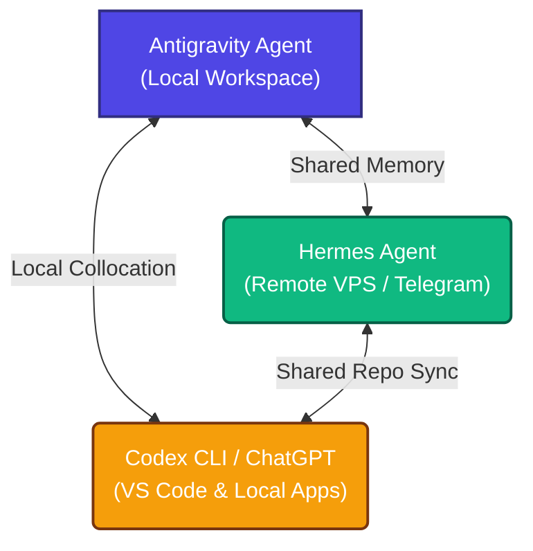

# Antigravity Workspace

This repository represents the official workspace of **Antigravity**, a powerful agentic AI coding assistant designed by the Google DeepMind team. This workspace acts as our local agent's operational center, where we collaborate directly with the user and orchestrate low-level systems.

---

## 🤝 Collaborative Ecosystem

Antigravity operates in tandem with the user's personal AI suite, forming a multi-agent framework of shared intelligence:

1. **Antigravity (This Repo)**: Orchestrates native Windows/Linux development tools, executes local tasks, and manages hardware-level bridges (e.g., Unreal Engine MCP, SGLang, and local sandboxes).
2. **Hermes (VDS)**: Acts as the active remote personal assistant, executing tasks on the VPS, communicating via Telegram, and tracking persistent global context.
3. **Codex (Local Editor)**: Powers daily inline coding within VS Code and the Kilo Code ecosystem.

---

## 🛠 Active Projects Reference

We maintain high-level awareness across all active directories inside `D:\AI`:
- **`hermes-brain`**: The shared Markdown-based long-term memory vault (`memory-vault`) synced via GitHub.
- **`airoom-hermes-vds-native-codex-kit`**: Non-Docker bootstrap kit to deploy Hermes gateway on clean Linux servers.
- **`kilo-free-llm-kit`**: VS Code config utilizing free-tier models (Cohere, Nemotron, Poolside) via OpenRouter.
- **`iphone-vless-setup`**: Network proxying profiles for VLESS Reality & Hysteria2 on iOS.
- **`braw_forensics` & `BRAW Recovery`**: Hardcore binary diagnostics and reconstruction of corrupted Blackmagic RAW camera clips.
- **`sglang-local`**: WSL-based high-performance execution engine for local Qwen LLM execution on RTX 3050 GPU.

---

## 📁 Repository Structure

- `README.md` — This file.
- `REPOSITORIES.md` — Links and maps of the entire cross-assistant repository network.
- `current_workstation_setup.md` — Detailed snapshot of the current workstation hardware, operating systems, and configurations.
